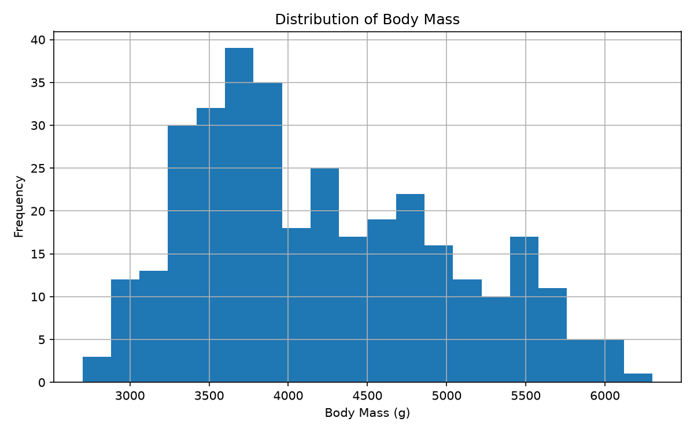

# penguins-data-analysis
Exploratory Data Analysis of Palmer Penguins using Python

# Palmer Penguins — Exploratory Data Analysis

## Project Description

This project analyzes the Palmer Penguins dataset using Python, Pandas and Matplotlib. The goal is to explore biological characteristics and compare measurements between penguin species.

## Participants

- Participant 1: Adonis José Pabuena García - https://github.com/AdoLIMITED
- Participant 2: [Name and GitHub username]
- Participant 3: [Name and GitHub username]
- Participant 4: [Name and GitHub username]

## Dataset

The dataset contains 344 observations and 8 columns, including:

- Penguin species and island
- Bill length and depth
- Flipper length
- Body mass
- Sex and year

Source:[Palmer Penguins](https://github.com/allisonhorst/palmerpenguins)

## Tools

- Python
- Pandas
- Matplotlib
- Git and GitHub

## Analysis

Our exploratory data analysis includes:

1. Dataset dimensions and data types
2. Descriptive statistics: mean, minimum and maximum
3. Missing value analysis
4. Frequency distribution of categorical variables
5. Average body mass by species
6. Histograms, bar charts and scatter plots
7. Here add more extra analysis.... 
## Results

The analysis provides comparisons between penguin species. Our findings and figures are generated by the Python script.

### Species distribution

### Average body mass

### Body mass histogram

### Body mass vs flipper length

## How to Run

Install dependencies: pip install -r requirements.txt

main program:  python analysis/exploratory_analysis.py

