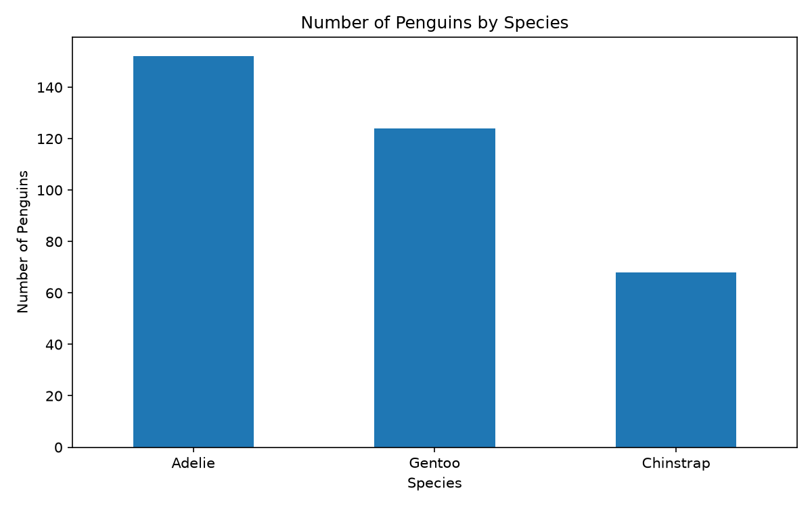
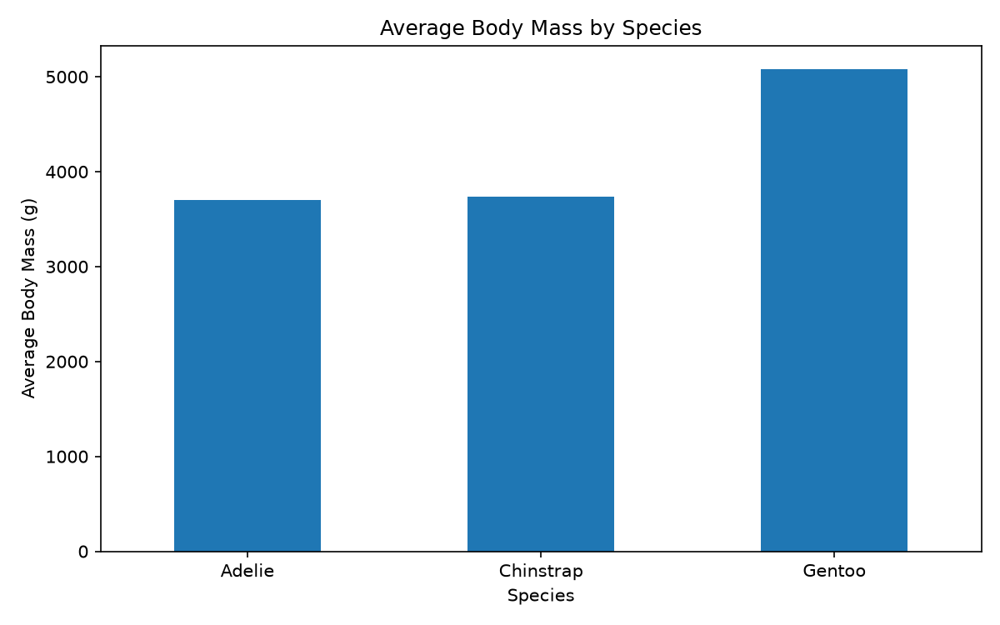
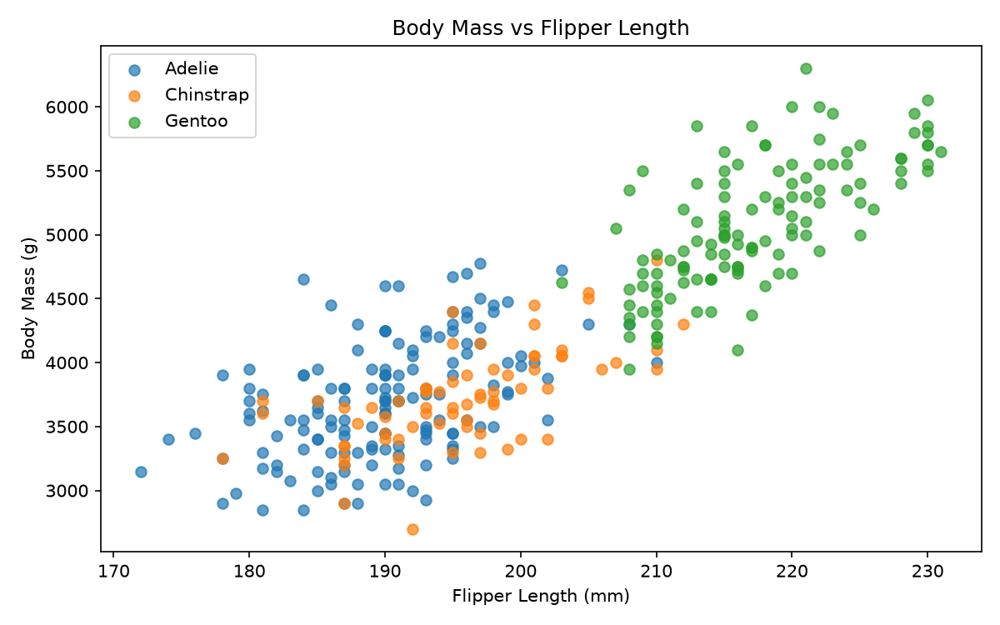
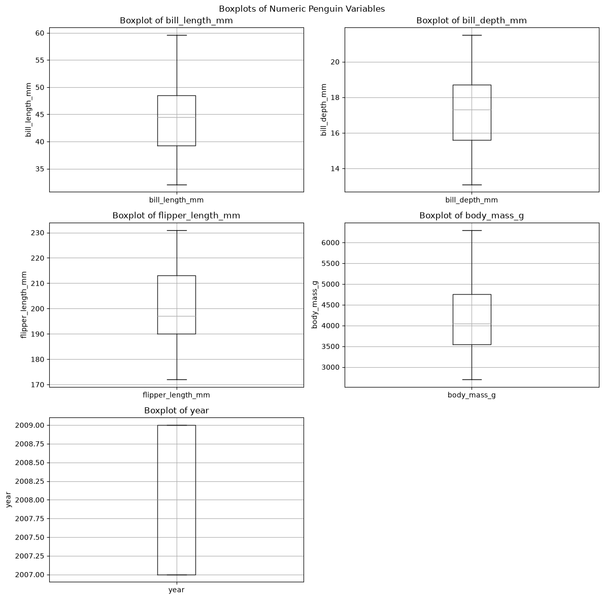
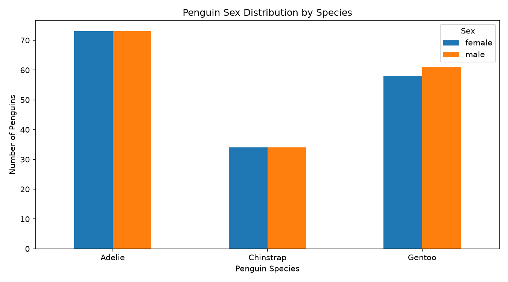
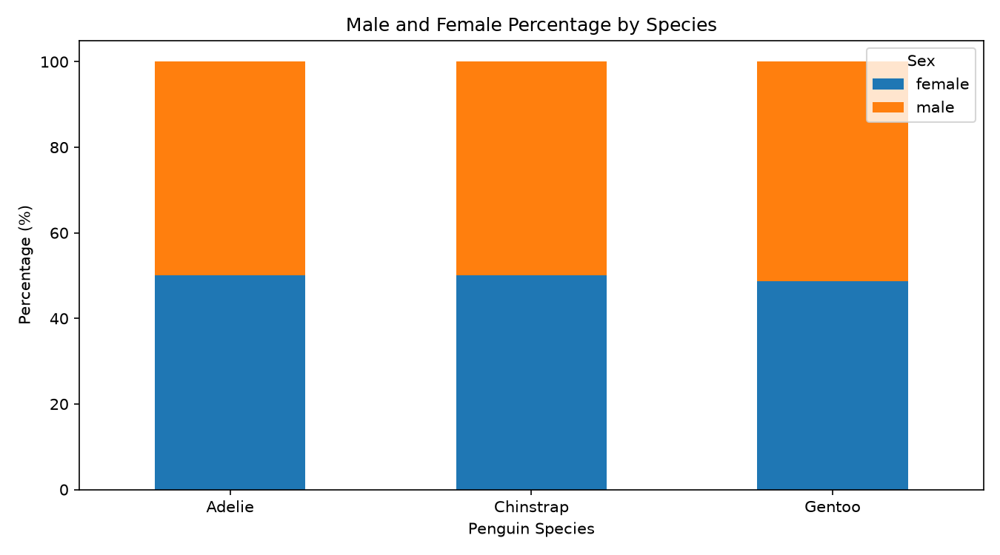
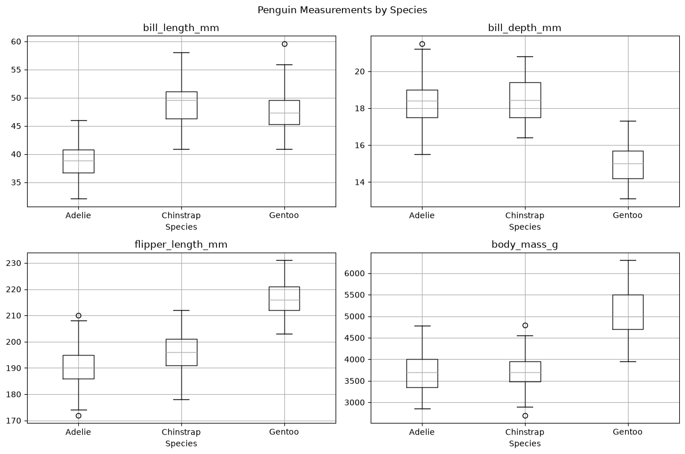

# penguins-data-analysis
Exploratory Data Analysis of Palmer Penguins using Python

# Palmer Penguins — Exploratory Data Analysis

## Project Description

This project analyzes the Palmer Penguins dataset using Python, Pandas and Matplotlib. The goal is to explore biological characteristics and compare measurements between penguin species.

## Participants

- Participant 1: Adonis José Pabuena García (owner) - https://github.com/AdoLIMITED
- Participant 2: Adonis José Pabuena García (contributor) - https://github.com/apabuena-spec
- Participant 3: Carlos Huertas Charriel (contributor) - https://github.com/CarlosHuertasCharriel
- Participant 4: María Jimeno González (contributor) - https://github.com/mjimgon
- Participant 5: [Name and GitHub username]
- Participant 5: [Name and GitHub username]
- Participant 6: [Name and GitHub username]

## Dataset

The dataset contains 344 observations and 8 columns, including:

- Penguin species and island
- Bill length and depth
- Flipper length
- Body mass
- Sex and year

Source:[Palmer Penguins](https://github.com/allisonhorst/palmerpenguins)

## Tools

- Python
- Pandas
- Matplotlib
- Git and GitHub

## Analysis

Our exploratory data analysis includes:

1. Dataset dimensions and data types
2. Descriptive statistics: mean, minimum and maximum
3. Missing value analysis
4. Frequency distribution of categorical variables
5. Average body mass by species
6. Histograms, bar charts and scatter plots
7. Species and sex analysis 

## Results

The analysis provides comparisons between penguin species. Our findings and figures are generated by the Python script.

### Species distribution

### Average body mass

### Body mass histogram

### Body mass vs flipper length

### Boxplot Distribution

## Additional Analysis: Species and Sex Distribution

This analysis examines the distribution of male and female penguins within each species.

We calculated:
- Number of males and females per species.
- Percentage of males and females within each species.
- Differences in sex distribution between species.

### Sex Distribution by Species

### Percentage Distribution by Species

### Measurements Distribution by Species

### Findings

- Adelie: 73 females and 73 males, equally distributed among observations with known sex.
- Chinstrap: 34 females and 34 males, also equally distributed.
- Gentoo: 58 females and 61 males, showing a slightly higher proportion of males. Gentoo penguins have the longest average flipper length and the highest average body mass, but the lowest average bill depth.

## How to Run

Install dependencies: pip install -r requirements.txt

main program:  python analysis/exploratory_analysis.py

